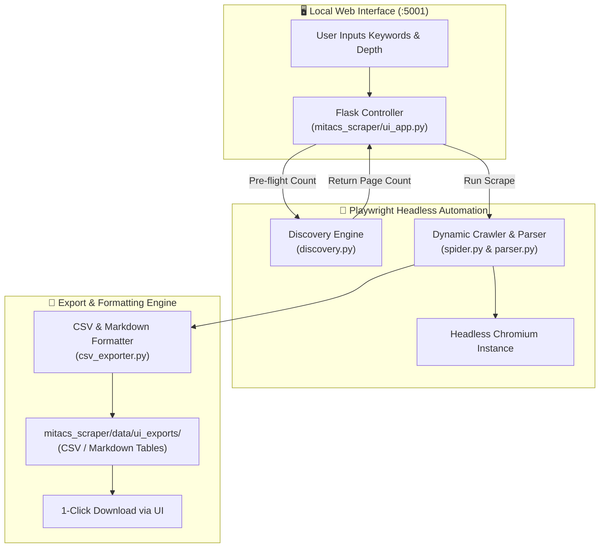

# 🔬 MITACS Globalink Research Projects Scraper & Intelligence Suite

<div align="center">

[](https://www.python.org/)
[](https://playwright.dev/)
[](https://flask.palletsprojects.com/)
[](mitacs_scraper/data/ui_exports/)
[](run_ui.bat)
[](README.md)

**A high-performance, browser-driven data extraction and exploration workstation for the MITACS Globalink Research Internship platform. Features multi-keyword parallel crawling, pre-scrape page volume detection, granular metadata extraction, and an interactive Flask UI.**

[Key Features](#-key-features) • [Workflow Architecture](#-workflow-architecture) • [Quick Start](#-quick-start) • [Local API Reference](#-local-rest-api) • [Extracted Schema](#-extracted-data-schema)

</div>

---

## ⚡ Key Features

- **🚀 Multi-Keyword Parallel Extraction**: Ingest and process up to 10 research domains or keywords simultaneously (e.g. *Biomedical, Machine Learning, Genomics, Robotics*).
- **🔍 Instant Page-Count Pre-Flight**: Queries the MITACS database to inspect total matching projects and available pages *before* initiating full downloads.
- **🛡️ Headless Browser Automation**: Leverages Playwright with headless Chromium to bypass JavaScript-rendered client hydrations and dynamic state transitions.
- **🎯 Granular Research Filtering**: Filter records by language (English / French), Canadian province, host university, faculty supervisor, and minimum academic achievement requirements.
- **📊 Multi-Format Exporting**: Generates structured, analysis-ready datasets in `.csv`, `.md` (Markdown tables), and `.json` formats.
- **🧹 Clean Lifecycle Watchdog**: Includes a heartbeat watchdog that automatically terminates background browser processes when the browser UI tab is closed.

---

## 🏗️ Workflow Architecture



---

## 🚀 Quick Start

### Windows (1-Click Automated Setup)

1. Make sure you have [Python 3.11+](https://www.python.org/) installed (tick **Add Python to PATH**).
2. Double-click `run_ui.bat` or run from PowerShell:
   ```powershell
   .\run_ui.bat
   ```
   *The launcher automatically configures `.venv`, installs dependencies, downloads Playwright's Chromium driver, and opens `http://127.0.0.1:5001` in your browser.*

### Manual Setup (Cross-Platform)

```bash
# Clone the repository
git clone https://github.com/Rahim36712/mitacs_projects_scraper.git
cd mitacs_projects_scraper

# Create and activate virtual environment
python -m venv .venv
source .venv/bin/activate  # Windows: .venv\Scripts\activate

# Install dependencies and Playwright browser binaries
pip install -r mitacs_scraper/requirements.txt
playwright install chromium

# Launch the Flask web workstation
python -m mitacs_scraper.ui_app
```

Navigate to **http://127.0.0.1:5001** to start exploring projects.

---

## 📖 How to Use the UI

1. **Enter Keywords**: Type target domains (e.g., `cancer research`, `deep learning`, `bioinformatics`).
2. **Check Available Pages**: Click **"Check available pages"** to retrieve exact real-time matching project counts (e.g., `📄 27 pages · ~265 projects`).
3. **Configure Depth & Filters**: Choose whether to scrape all pages or limit to a specific count (e.g., first 5 pages).
4. **Start Extraction**: Watch the live progress bar as cards are parsed and structured.
5. **Download Export**: Grab your structured CSV or Markdown report with one click!

---

## 📡 Local REST API

The embedded Flask server exposes clean REST endpoints:

| Endpoint | Method | Purpose |
|:---:|:---:|---|
| `/api/health` | `GET` | Health check and server status. |
| `/api/heartbeat` | `GET/POST` | UI keep-alive ping for automated browser cleanup. |
| `/api/count` | `POST` | Pre-flight check: query total projects and pages for keyword list. |
| `/api/scrape` | `POST` | Dispatches background scraping job and outputs export files. |
| `/api/exports` | `GET` | Lists all generated files in `data/ui_exports/`. |
| `/download/<filename>` | `GET` | Download a specific exported dataset. |

### Sample Pre-flight Request

```http
POST /api/count HTTP/1.1
Content-Type: application/json

{
  "keywords": ["bioinformatics", "quantum computing"]
}
```

```json
{
  "results": [
    {
      "keyword": "bioinformatics",
      "total_projects": 142,
      "per_page": 10,
      "total_pages": 15
    },
    {
      "keyword": "quantum computing",
      "total_projects": 88,
      "per_page": 10,
      "total_pages": 9
    }
  ]
}
```

---

## 📋 Extracted Data Schema

Each project row contains 10+ structured fields:

| Field Name | Type | Description |
|---|:---:|---|
| `project_id` | String | Unique MITACS internal identifier. |
| `title` | String | Official academic research title. |
| `professor` | String | Lead faculty investigator / supervisor name. |
| `university` | String | Host Canadian institution (e.g. *University of Toronto*). |
| `province` | String | Canadian province/territory (e.g. *Ontario, BC, Quebec*). |
| `language` | String | Working language (`English`, `French`). |
| `academic_level` | String | Minimum requirements (*Undergraduate, Master's*). |
| `required_skills`| String | Specific prerequisite proficiencies and domain knowledge. |
| `start_date` | String | Program term and intake dates. |
| `description` | Text | Full project synopsis and research objectives. |

---

## 📁 Repository Structure

```
mitacs_projects_scraper/
├── mitacs_scraper/
│   ├── data/
│   │   └── ui_exports/           # Generated CSV & Markdown exports
│   ├── scraper/
│   │   ├── discovery.py          # Pre-flight page counter & validator
│   │   ├── fetcher.py            # Playwright browser manager
│   │   ├── parser.py             # DOM node parser & project extractor
│   │   └── spider.py             # Pagination controller
│   ├── storage/
│   │   ├── csv_exporter.py       # Output table serializer
│   │   └── database.py           # Optional SQLite cache
│   ├── templates/
│   │   └── index.html            # Web dashboard (Modern CSS, Tailwind, JS)
│   ├── config.py                 # Crawler timeouts & selectors
│   └── ui_app.py                 # Flask server & REST controller
├── run_ui.bat                    # 1-click Windows bootstrap script
└── README.md                     # Project documentation
```

---

<div align="center">
  <sub>Built for academic research intelligence and scholarship exploration.</sub>
</div>
